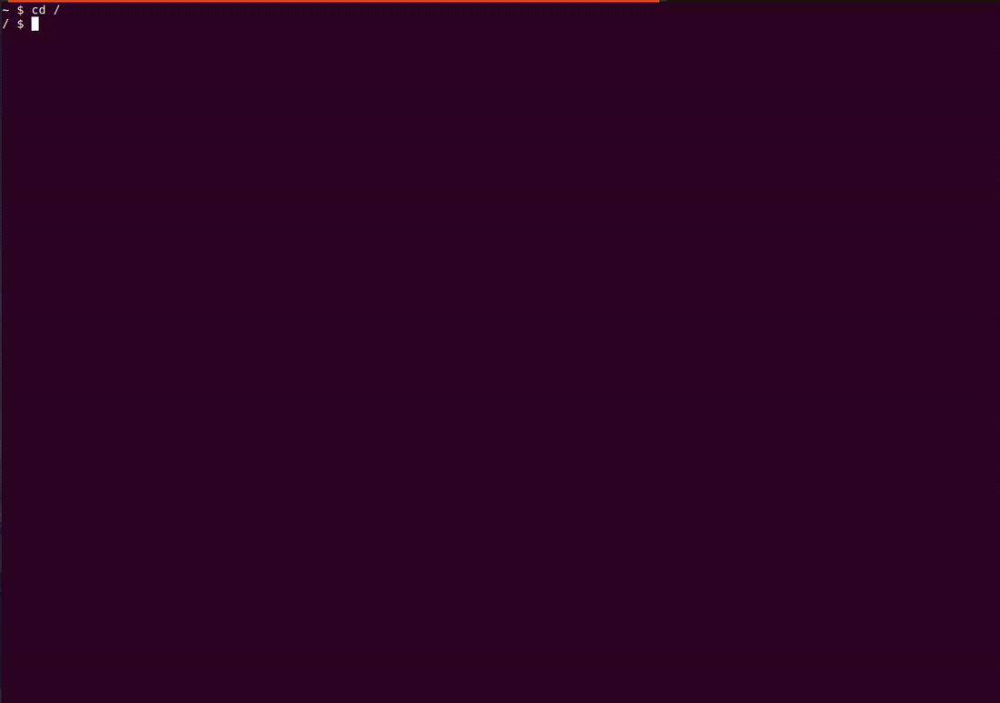

# CVE-2025-38471 — Linux Kernel TLS RX Use-After-Free

This is my analysis and PoC for **CVE-2025-38471**. I reproduced the bug on **Linux 6.16.0-rc5** in QEMU. KASAN reported a **slab-use-after-free**.

I used GDB/GEF to see what happened inside the kernel. The PoC also triggered the bug **without GDB**.

| Item | Details |
| --- | --- |
| CVE | [CVE-2025-38471](https://www.cve.org/CVERecord?id=CVE-2025-38471) |
| Kernel tested | Linux 6.16.0-rc5 |
| Environment | QEMU, x86-64, KASAN enabled; 2 vCPUs seen in GDB |
| Main files | `net/tls/tls_strp.c`, `net/ipv4/tcp_input.c` |
| Fix | `tls: always refresh the queue when reading sock` |
| Result | KASAN UAF read with and without GDB |
| Test date | 2026-11-16 |

**Note:** This PoC shows a UAF read. I did not test privilege escalation or code execution. I have not tested the PoC on a patched kernel yet.

## PoC Demo



The GIF shows my PoC running in QEMU. It ends with a KASAN report. The GIF and the GDB logs are from separate runs, so their memory addresses may be different.

```text
BUG: KASAN: slab-use-after-free in tls_strp_check_rcv+0x839/0x9b0
Read of size 4 at addr ffff88800877e108 by task test/80
CPU: 1 UID: 1000 PID: 80 Comm: test Not tainted 6.16.0-rc5 #1 PREEMPT(voluntary)
```

## Test Results

I ran the PoC in two ways:

| Test | Result |
| --- | --- |
| With GDB/GEF | UAF triggered. I also traced the SKB free and the bad read. |
| Without GDB | UAF triggered. No breakpoint or single-step was needed. |

I have not measured the success rate over many runs.

## 1. Why the Bug Happens

The TLS RX parser uses `anchor->frag_list` to remember an SKB from the TCP receive queue.

This is only a pointer. It does not keep the SKB alive.

When TCP has receive-memory pressure, `tcp_collapse()` may move data into a new SKB. It then removes and frees the old SKB.

The problem is that the TLS anchor can still point to the old SKB.

In the vulnerable code, `tls_strp_read_sock()` reloads the TCP queue only when `strp->stm.full_len` is zero:

```c
if (inq < strp->stm.full_len)
    return tls_strp_read_copy(strp, true);

if (!strp->stm.full_len) {
    tls_strp_load_anchor_with_queue(strp, inq);
    /* Read the TLS record length. */
}

if (!tls_strp_check_queue_ok(strp))
    return tls_strp_read_copy(strp, false);
```

If `full_len` is already set, the parser can skip the queue reload. Later, `tls_strp_check_queue_ok()` uses the old pointer:

```c
first = skb_shinfo(strp->anchor)->frag_list;
skb = first;
seq = TCP_SKB_CB(first)->seq;
```

If TCP has already freed `first`, this becomes a **use-after-free read**.

```text
Before TCP collapse:

TCP receive queue: [ SKB A ]
                       ^
TLS anchor->frag_list --+

After TCP collapse:

TCP receive queue: [ New SKB ]
TLS anchor->frag_list --> SKB A (freed)

Later TLS callback:
  -> skips queue reload
  -> reads SKB A
  -> KASAN: slab-use-after-free
```

## 2. My TCP SKB Observations

### 2.1 Why the next send did not merge into SKB A

First, I sent `0x3c0` bytes 17 times. TCP put the data into SKB A.

GDB showed:

```text
SKB A:
  len       = 0x3fc0
  data_len  = 0x3fc0
  nr_frags  = 17
  truesize  = 0x4380

Next incoming SKB:
  len       = 0x40
  data_len  = 0x40
  nr_frags  = 1
```

The next `0x40` bytes did not merge into SKB A. The reason was the fragment limit.

```text
17 + 1 = 18
MAX_SKB_FRAGS = 17
18 > 17
```

I also saw the failed check in the assembly:

```asm
cmp r11d, 0x11  ; limit = 17
jg  ...         ; branch taken (total = 18)
```

The related C code is:

```c
if (to_shinfo->nr_frags + from_shinfo->nr_frags > MAX_SKB_FRAGS)
    return false;
```

So TCP kept the next data in another SKB, even though the sequence numbers were continuous.

### 2.2 Why TCP did not free SKB A at first

At first, SKB A had a lot of data. TCP often skipped it during `tcp_collapse()`.

In one test, I saw:

```text
A->len        = 0x1100
A->truesize   = 0x14c0
scaling_ratio = 0x80
start         = A->seq
TCP flags     = 0x18 (PSH | ACK)
```

The value of `tcp_win_from_space(sk, A->truesize)` was `0xa60`.

```text
0xa60 > 0x1100  -> false
```

There was no sequence overlap, either. So this test did not select A for copying.

I then changed the small writes to `0x20` bytes each. This changed the amount of data compared with the SKB memory size. I checked the selection logic in `tcp_collapse()`:

```c
if (!(TCP_SKB_CB(skb)->tcp_flags & (TCPHDR_SYN | TCPHDR_FIN)) &&
    (tcp_win_from_space(sk, skb->truesize) > skb->len ||
     before(TCP_SKB_CB(skb)->seq, start))) {
    end_of_skbs = false;
    break;
}
```

Here, `break` means TCP found an SKB to work on. It does **not** free the SKB yet. The later copy path can call `tcp_collapse_one()` to remove the old SKB.

### 2.3 How I reached `tcp_collapse()`

I changed `SO_RCVBUF` while sending more data. This made TCP enter its receive-memory cleanup path.

With `SO_RCVBUF = 0`, I saw an actual `sk_rcvbuf` value of `0x900`. The kernel keeps a minimum buffer size.

My call trace was:

```text
tcp_data_queue()
  -> tcp_try_rmem_schedule()
     -> tcp_prune_queue()
        -> tcp_collapse()
           -> tcp_collapse_one()
```

After this, I increased `SO_RCVBUF` again. In another check, the actual value was `0x68000`.

I did this to reduce receive-memory pressure and avoid the TLS copy path. In the later TLS checks, I observed `copy_mode = 0`.

## 3. GDB Proof: The Old SKB Was Freed

### 3.1 Original SKB in the receive queue

Before the collapse, the queue had one SKB:

```gdb
gef> p sk->sk_receive_queue

next = 0xffff88800877e0e0
prev = 0xffff88800877e0e0
qlen = 0x1
```

### 3.2 `tcp_collapse_one()` used the same SKB

Later, I stopped at `tcp_collapse_one()`:

```text
#0 tcp_collapse_one
#1 tcp_collapse+0x970
#2 tcp_try_rmem_schedule+0x710 (tcp_prune_queue)
#3 tcp_data_queue+0xf02
#4 tcp_rcv_established+0x66a
```

```gdb
gef> p skb
$2 = (struct sk_buff *) 0xffff88800877e0e0
```

At this point the queue had three SKBs. TCP had added replacement data during the collapse work:

```text
next = 0xffff888007a74280
prev = 0xffff888007ff4d60
qlen = 0x3
```

`tcp_collapse_one()` removes the old SKB with `__skb_unlink()` and then calls `__kfree_skb()`.

### 3.3 TLS still used the old SKB address

After more normal data and an `MSG_OOB` send, I reached `tls_strp_check_queue_ok()`.

```c
first = skb_shinfo(strp->anchor)->frag_list;
skb = first;
seq = TCP_SKB_CB(first)->seq;
```

GDB showed:

```gdb
gef> p first
$7 = (struct sk_buff *) 0xffff88800877e0e0
```

The address was the same:

```text
SKB used by tcp_collapse_one(): 0xffff88800877e0e0
TLS cached first pointer:       0xffff88800877e0e0
```

KASAN then reported a read at `0xffff88800877e108`. This is `0x28` bytes after the start of that SKB. In this kernel build, this matches the TCP sequence field read.

## 4. Why the TLS Queue Check Was Reached

My TLS 1.2 Application Data header used this payload length:

```c
buffer[0] = 0x17;
buffer[1] = 0x03;
buffer[2] = 0x03;
buffer[3] = 0x20;
buffer[4] = 0x00;
```

The payload length was `0x2000`. With the 5-byte TLS header, `full_len` was `0x2005`.

At the last callback, GDB showed:

```text
inq                = 0x2362
strp->stm.full_len = 0x2005
copy_mode          = 0 (seen before the final check)
```

So:

```text
0x2362 >= 0x2005
```

The parser did not take the `inq < full_len` return. `full_len` was also not zero, so it skipped `tls_strp_load_anchor_with_queue()`.

It then called `tls_strp_check_queue_ok()` and read the old SKB pointer.

I also tried `recv(server, ..., 0x3c0, 0)` earlier. That call did not add new TCP data. The final UAF happened after the TCP urgent-data callback, not directly from that `recv()` call.

## 5. KASAN Call Trace

This is from my own QEMU test:

```text
BUG: KASAN: slab-use-after-free in tls_strp_check_rcv+0x839/0x9b0
Read of size 4 at addr ffff88800877e108 by task test/80

Call Trace:
 <IRQ>
 dump_stack_lvl+0x53/0x70
 print_report+0xd0/0x670
 kasan_report+0xce/0x100
 tls_strp_check_rcv+0x839/0x9b0
 tls_data_ready+0xed/0x430
 tcp_urg+0x5b9/0xc50
 tcp_rcv_established+0x65f/0x2210
 tcp_v4_do_rcv+0x525/0x8a0
 tcp_v4_rcv+0x2a86/0x4210
 ip_protocol_deliver_rcu+0x61/0x2e0
 ip_local_deliver_finish+0x277/0x360
 ip_local_deliver+0x18f/0x2d0
 ip_rcv+0x21a/0x270
 __netif_receive_skb_one_core+0x161/0x1b0
 process_backlog+0x18f/0x560
 __napi_poll+0x9e/0x500
 net_rx_action+0x9ad/0xea0
 handle_softirqs+0x18c/0x530
```

The important part is:

```text
tcp_urg()
  -> tls_data_ready()
     -> tls_strp_check_rcv()
        -> UAF read
```

This callback path is different from the upstream report's `tls_rx_rec_wait()` / `tls_sw_recvmsg()` path.

## 6. The Fix

The patch moves `tls_strp_load_anchor_with_queue()` outside the `if (!strp->stm.full_len)` block:

```diff
 if (inq < strp->stm.full_len)
     return tls_strp_read_copy(strp, true);

+tls_strp_load_anchor_with_queue(strp, inq);
 if (!strp->stm.full_len) {
-    tls_strp_load_anchor_with_queue(strp, inq);
-
     sz = tls_rx_msg_size(strp, strp->anchor);
```

Now the TLS parser refreshes the queue before it checks the record. It does this even when `full_len` is already known.

Fix commit: [`4ab26bce3969f8fd925fe6f6f551e4d1a508c68b`](https://git.kernel.org/pub/scm/linux/kernel/git/stable/linux.git/commit/?id=4ab26bce3969f8fd925fe6f6f551e4d1a508c68b).

I have not run my PoC on a patched kernel yet.

I used the same SKB address to connect these events: it was in the TCP queue, TCP freed it, TLS still pointed to it, and KASAN reported a read from it.

## References

- [Linux CVE announcement](https://lists.openwall.net/linux-cve-announce/2025/07/28/15)
- [Upstream patch discussion](https://lists.openwall.net/netdev/2025/07/16/181)
- [Fix commit](https://git.kernel.org/pub/scm/linux/kernel/git/stable/linux.git/commit/?id=4ab26bce3969f8fd925fe6f6f551e4d1a508c68b)
- [Linux 6.16-rc5 TLS source](https://github.com/torvalds/linux/blob/v6.16-rc5/net/tls/tls_strp.c)
- [Linux 6.16-rc5 TCP source](https://github.com/torvalds/linux/blob/v6.16-rc5/net/ipv4/tcp_input.c)

## Conclusion

I reproduced **CVE-2025-38471** on Linux 6.16.0-rc5. TCP freed an SKB, but the TLS anchor still had its old address. Later, the TLS parser read that freed SKB. KASAN detected the UAF.

The PoC worked **with GDB and without GDB**.